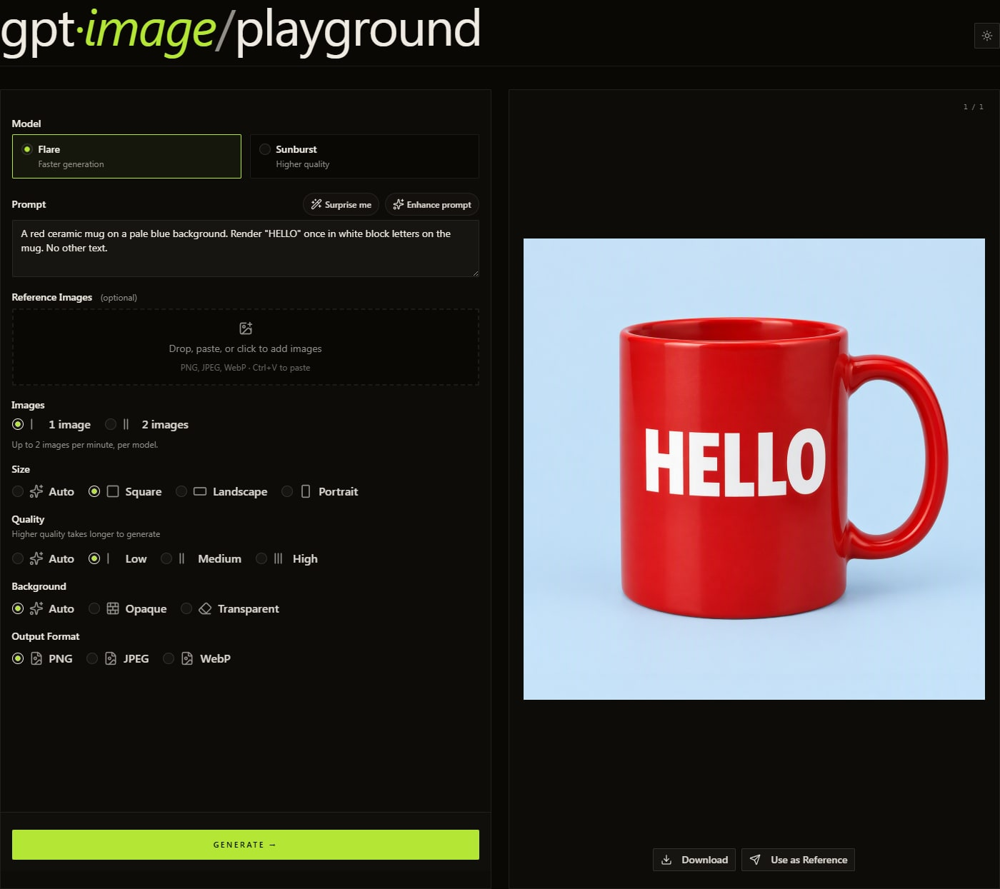
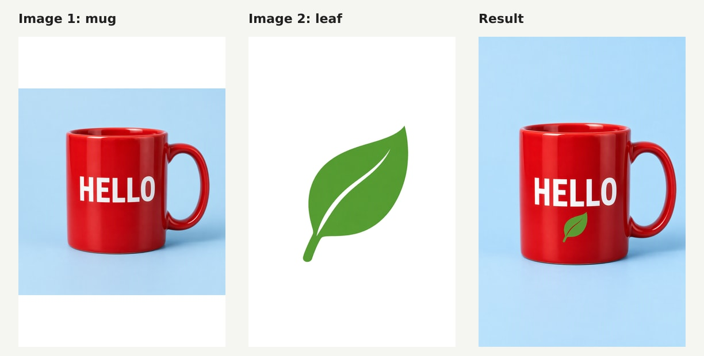

# GPT Image Playground

Generate and edit images with MAI Image 2.7 (default) or GPT Image 2.5 Flare and Sunburst, using reference images, prompt enhancement, and local history.



## Quick start

Use Node.js 26 LTS (npm comes with it).

```bash
git clone https://github.com/illgitthat/gpt-image-playground.git
cd gpt-image-playground
npm install
cp .env.local.example .env.local
```

Add your API configuration to `.env.local` using one of the options below, then run:

```bash
npm run dev
```

Open [localhost:3000](http://localhost:3000).

## Configuration

For the OpenAI API:

```dotenv
OPENAI_API_KEY=your-api-key
```

For an Azure-compatible gateway:

```dotenv
AZURE_OPENAI_API_KEY=your-api-key
AZURE_OPENAI_ENDPOINT=https://your-gateway.com/openai/v1
```

The gateway must support the `x-ms-oai-image-generation-deployment` header and have both image models deployed. This is a gateway integration, not a direct Azure OpenAI connection.

| Optional setting | Purpose |
| --- | --- |
| `MAI_IMAGE_ENDPOINT` | MAI image API base ending in `/mai/v1`, required for the default MAI Image 2.7 model. Uses `AZURE_OPENAI_API_KEY` unless `MAI_IMAGE_API_KEY` is set. |
| `AZURE_OPENAI_TEXT_MODEL` | Text model for image orchestration and prompt tools. Defaults to `gpt-chat-latest`; choose a model available at your endpoint. |
| `OPENAI_API_BASE_URL` | Custom base URL for OpenAI-compatible connections. |
| `APP_PASSWORD` | Require a shared password. |
| `ENABLED_IMAGE_MODELS` | Comma-separated image models the server accepts (default `MAI-Image-2.7`). Requests for other models are served with the first enabled model. |
| `IMAGE_LIMIT_PER_IP_HOUR` / `IMAGE_LIMIT_PER_IP_DAY` | Images each client IP may request (defaults 60 / 250; `0` disables). |
| `TEXT_LIMIT_PER_IP_HOUR` | Prompt enhance + surprise-me calls per IP per hour (default 120). |
| `VIDEO_ENDPOINT` | Base URL of one fal video model on Microsoft Foundry, e.g. `https://<gateway>/<resource>/providers/falai/v1/minimax/h3-max-turbo`. Video is hidden until this is set. Uses `AZURE_OPENAI_API_KEY` unless `VIDEO_API_KEY` is set. |
| `VIDEO_MODEL` | Foundry deployment name for the video model (default `Fal-MiniMax-H3-Max-Turbo`). |
| `VIDEO_SECONDS` / `VIDEO_RESOLUTION` | Default clip length (default 5; people can also pick 5 or 10) and `480P`, `768P` or `1080P` (default `768P`). |
| `VIDEO_LIMIT_PER_IP_DAY` | Video generations per IP per day (default 10). |
| `IMAGE_LOG_FILE` | JSONL log of image requests (time, status, model, prompt, settings, client IP, files). Defaults to `logs/image-generations.jsonl`; set to `off` to disable. |
| `SITE_URL` | Public address of the site, e.g. `https://images.example.com`. Lets link previews show the preview image. |
| `NEXT_PUBLIC_IMAGE_STORAGE_MODE` | `fs` saves images in `generated-images/`; `indexeddb` saves them in the browser. Defaults to `fs` locally and `indexeddb` on Vercel. |

Behind a reverse proxy, serve finished videos (`/api/image/<id>-video.mp4`) straight from `generated-images/`. The app sends files without a `Content-Length`, and Safari will not play a video it cannot fetch in byte ranges.

Reference images and history are stored in the browser. Use `indexeddb` on hosts without persistent writable storage.

## Using the playground

Images are generated with **MAI 2.7** as WebP (quality 85). The form only asks for a prompt, optional reference images, image count, and size. Set `ENABLED_IMAGE_MODELS` to re-enable GPT Image models for API callers. Enter a prompt, select your output settings, and generate. You can download results or reuse them as references.

For edits, add images by dropping, pasting, or uploading them. Refer to them by number and state what should change:

> Add the leaf from Image 2 below "HELLO" on the mug in Image 1. Preserve the mug, lettering, and pale blue background.



**Enhance prompt** refines your wording; **Surprise me** creates an idea. Use Undo to restore the previous prompt. History lets you reuse a prompt together with its references.

### Current limits

The app allows **2 images per batch** and **2 requests per minute, per model**. These are app limits, not provider limits. They are hardcoded in [`src/lib/image-options.ts`](./src/lib/image-options.ts); there is no environment setting to change them.

Size controls are limited to auto, square, landscape, and portrait; quality controls offer auto, low, medium, and high. The models support additional settings, but this integration does not expose them. See the [OpenAI image guide](https://developers.openai.com/api/docs/guides/image-prompting) for model capabilities and [prompt-guide.md](./prompt-guide.md) for prompting advice.

## Development

| Command | Purpose |
| --- | --- |
| `npm run dev` | Start the development server. |
| `npm run typecheck` | Check application and test types. |
| `npm run lint` | Run ESLint. |
| `npm test` | Run tests (Vitest) without paid API calls. |
| `npm run format` | Format source files. |

Pull requests run type checks, lint, tests, and a production build.

## Deployment

```bash
npm ci
npm run build
npm run start
```

The [`deploy/`](./deploy) folder has what the production server (images.adamcbloom.com) uses:

- [`gpt-image-playground.service`](./deploy/gpt-image-playground.service): systemd unit that runs `next start` with Node. Adjust its user, working directory, and port for your host.
- [`gpt-image-playground-update`](./deploy/gpt-image-playground-update): auto-update script (run by a systemd timer every 5 minutes). It fast-forwards to `origin/main`, reinstalls dependencies only when `package-lock.json` changed, builds, and restarts the service.
- [`nginx-site.conf`](./deploy/nginx-site.conf): local-only nginx site in front of the app. Public traffic arrives through a Cloudflare Tunnel (`cloudflared`), so the server needs no open web ports.

For any reverse proxy, allow long-running requests and disable response buffering so image previews can stream.

## License

[MIT](./LICENSE)
